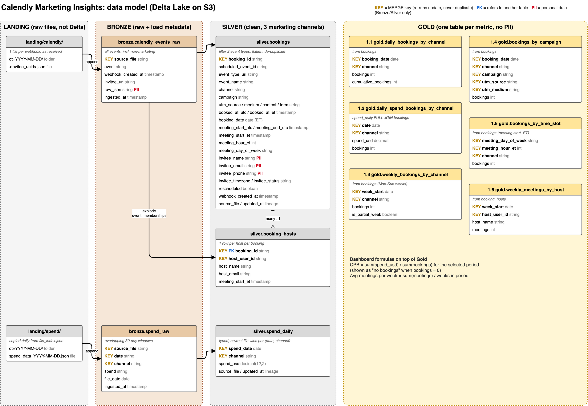

# Data model: Bronze / Silver / Gold

Status: **approved by the SME (2026-11-18)**. Architecture: [architecture.png](architecture.png).



Editable source: [data_model.drawio](data_model.drawio) (open with draw.io).

All tables are **Delta Lake tables on S3**, encrypted with SSE-KMS. One PySpark job on EMR Serverless
builds them daily. Every write is a Delta `MERGE` keyed on the columns marked **key**, so re-running
the job after a failure never creates duplicates.

```
S3 landing/ (raw JSON files, as received)
   │
   ▼
BRONZE  raw rows + load metadata, nothing dropped or changed
   │
   ▼
SILVER  flattened, typed, de-duplicated, channel tagged (3 marketing channels only)
   │
   ▼
GOLD    one small table per dashboard metric
```

## Rules that apply everywhere (SME-confirmed 2026-11-16)
- **Booking date** = `payload.created_at` (when the lead booked), converted to **US Eastern**.
- **Time slot** (metric 1.5) = meeting `payload.scheduled_event.start_time`, converted to US Eastern.
- **Channel** comes from `payload.scheduled_event.event_type`:

  | event_type URI ends with | channel |
  |---|---|
  | `79652b8a-1688-4d0b-ba8f-733c70856de4` | facebook_paid_ads |
  | `2b5580c2-13e9-4283-8b4d-56401cf31554` | youtube_paid_ads |
  | `70022cde-e64f-49a0-9362-a815186005dc` | tiktok_paid_ads |
  | anything else | not marketing: kept in Bronze only, filtered out before Silver |

- **Meeting load** (metric 1.6) counts only meetings from the 3 marketing channels (decided 2026-11-16).
- **Campaign** = `payload.tracking.utm_campaign`, or `"Unknown"` when null/empty.
- Only `invitee.created` events are used; cancellations are not tracked; no historical backfill.
- Timestamps are stored in **UTC**; US Eastern columns are derived next to them (suffix `_et`).
- Money: `decimal(12,2)`, USD.

---

## Landing zone (plain files, not Delta)
| Path | Written by | Content |
|---|---|---|
| `landing/calendly/dt=YYYY-MM-DD/<invitee_uuid>.json` | webhook Lambda | one webhook body, exactly as Calendly sent it |
| `landing/spend/dt=YYYY-MM-DD/spend_data_YYYY-MM-DD.json` | spend Lambda | one spend file, exactly as published |

`dt=` is the day we received the webhook (UTC), and for spend the publish day (file date + 1), so re-copying a spend file never makes a second copy. Landing files are kept, so any layer can be rebuilt from them.

---

## Bronze

### bronze.calendly_events_raw
One row per webhook body received. Everything is kept, including non-marketing events.

| Column | Type | Source | Notes |
|---|---|---|---|
| **source_file** | string | S3 key of the landing file | key; makes re-loading the same file a no-op |
| event | string | `event` | always `invitee.created` |
| webhook_created_at | timestamp | `created_at` (top level) | when Calendly fired the webhook |
| invitee_uri | string | `payload.uri` | used for de-duplication in Silver |
| raw_json | string | whole body | untouched copy |
| ingested_at | timestamp | job time | load metadata |

### bronze.spend_raw
One row per row in each spend file. Files overlap (each holds a rolling 30-day window), so the same
(date, channel) appears in up to 30 files here; Silver resolves that.

| Column | Type | Source | Notes |
|---|---|---|---|
| **source_file** | string | S3 key, e.g. `spend_data_2026-11-15.json` | key (with date, channel) |
| **date** | string | `date` | kept as text, typed in Silver |
| **channel** | string | `channel` | |
| spend | string | `spend` | kept as text, typed in Silver |
| file_date | date | parsed from the file name | newer file wins in Silver |
| ingested_at | timestamp | job time | |

---

## Silver

### silver.bookings
One row per marketing booking (invitee), 3 channels only. Non-marketing events are dropped here
(they stay in Bronze), so we keep no PII about people who are not marketing leads.
Contains PII: invitee name, email, phone. PII stays in Silver; Gold has none.

| Column | Type | Source (webhook JSON path) | Notes |
|---|---|---|---|
| **booking_id** | string | `payload.uri` | key; duplicate deliveries collapse to one row (latest `webhook_created_at` wins) |
| scheduled_event_id | string | `payload.scheduled_event.uri` | the meeting |
| event_type_uri | string | `payload.scheduled_event.event_type` | |
| event_name | string | `payload.scheduled_event.name` | |
| channel | string | mapped from `event_type_uri` | see table above |
| campaign | string | `payload.tracking.utm_campaign` | `"Unknown"` if missing |
| utm_source / utm_medium / utm_content / utm_term | string | `payload.tracking.*` | nullable |
| booked_at_utc | timestamp | `payload.created_at` | |
| booked_at_et | timestamp | derived | US Eastern |
| booking_date | date | date of `booked_at_et` | metrics 1.1–1.4 |
| meeting_start_utc | timestamp | `payload.scheduled_event.start_time` | |
| meeting_end_utc | timestamp | `payload.scheduled_event.end_time` | |
| meeting_start_et | timestamp | derived | metric 1.5 |
| meeting_hour_et | int | hour of `meeting_start_et` (0–23) | metric 1.5 |
| meeting_day_of_week | string | day name of `meeting_start_et` | metric 1.5 |
| invitee_name | string | `payload.name` | PII |
| invitee_email | string | `payload.email` | PII |
| invitee_phone | string | `payload.questions_and_answers[]` answer where question mentions "phone" | PII, nullable |
| invitee_timezone | string | `payload.timezone` | |
| invitee_status | string | `payload.status` | |
| rescheduled | boolean | `payload.rescheduled` | |
| webhook_created_at | timestamp | `created_at` (top level) | |
| source_file | string | from Bronze | lineage |
| updated_at | timestamp | job time | |

### silver.booking_hosts
One row per (booking, host). A meeting can have more than one host in `event_memberships`, so hosts
live in their own table instead of a list column.

| Column | Type | Source | Notes |
|---|---|---|---|
| **booking_id** | string | `payload.uri` | key (with host_user_id) |
| **host_user_id** | string | `payload.scheduled_event.event_memberships[].user` | the employee_id for metric 1.6 |
| host_name | string | `...event_memberships[].user_name` | |
| host_email | string | `...event_memberships[].user_email` | employee work email |
| meeting_start_et | timestamp | from silver.bookings | |

### silver.spend_daily
One row per (date, channel), the latest known spend.

| Column | Type | Source | Notes |
|---|---|---|---|
| **spend_date** | date | `date` | key (with channel) |
| **channel** | string | `channel` | |
| spend_usd | decimal(12,2) | `spend` | |
| source_file | string | the newest file containing this row | if a later file restates a value, it replaces the old one |
| updated_at | timestamp | job time | |

---

## Gold (one table per metric)
Gold tables hold counts and sums per day. The dashboard sums them over the period the user picks,
so ratios like CPB are always **total spend ÷ total bookings** for that period, never an average of daily ratios.

| Metric | Table | Grain (one row per) | Columns |
|---|---|---|---|
| 1.1 Daily calls by source | gold.daily_bookings_by_channel | booking_date, channel | bookings, cumulative_bookings |
| 1.2 CPB by channel | gold.daily_spend_bookings_by_channel | date, channel | spend_usd, bookings (full outer join: a day with spend and 0 bookings still appears) |
| 1.3 Bookings trend | gold.daily_bookings_by_channel (reused) + gold.weekly_bookings_by_channel | week_start (Monday), channel | bookings, is_partial_week |
| 1.4 Channel attribution | gold.bookings_by_campaign | booking_date, channel, campaign, utm_source, utm_medium | bookings |
| 1.5 Volume by time slot | gold.bookings_by_time_slot | meeting_day_of_week, meeting_hour_et, channel | bookings |
| 1.6 Meeting load | gold.weekly_meetings_by_host | week_start, host_user_id | host_name, meetings (marketing meetings only) |

Dashboard formulas on top of Gold:
- **CPB** = `sum(spend_usd) / sum(bookings)`; shown as "no bookings" when bookings = 0.
- **Avg meetings per week** (1.6) = `sum(meetings) / number of weeks in the selected period`.
- Weeks run Monday–Sunday; partial weeks at the edges are labelled.

---

## Resolved points (SME-confirmed 2026-11-16)
1. **Meeting load (1.6):** only the 3 marketing event types; a meeting counts in the week of its
   `start_time` (US Eastern, Monday–Sunday).
2. **"CPB by Channel and Campaign" heatmap (1.4):** spend exists per channel only, so the heatmap shows
   **bookings** by channel × campaign, and CPB is calculated at channel level only (no estimated
   per-campaign CPB).
